# dynamic-two-way-flowchart

深色科技风（HUD）双向动态流程图技能。用 SVG + CSS + SMIL 动画，把「节点 + 连线 + 流向」渲染成带双向数据包粒子的动态流程图，适合端到端调用链、架构流程、鉴权链路等场景。

## 效果预览

下面这张是可复用模板（`assets/template.svg`）的渲染效果——深色 HUD 背景、三阶段配色、双向数据包粒子、核心节点脉动：



> 提示：GitHub 预览图是静态的（动画会被 GitHub 图片代理吞掉）。要看完整动画效果，直接打开 `assets/template.svg`，或让 AI 内联渲染。

## 功能特性

- 深色 HUD 背景：网格点阵 + 四角角标 + 节点状态灯
- 双向数据包粒子：去程荧光色流动、返回暗灰回流
- 三阶段配色：认证蓝 `#4F8EF7` / 发现青 `#2DD4BF` / 调用绿 `#3EF08C`
- 动画：连线流动、节点淡入、核心脉动、状态灯呼吸
- 无障碍：`prefers-reduced-motion` 自动降级（隐藏粒子、停流动）

## 安装

技能位于 TraeCode 全局技能目录：

```
~/.trae-cn/skills/dynamic-two-way-flowchart/
```

新开会话后自动加载，无需手动安装。

## 使用方法

### 触发

对 AI 说：

- 「用 dynamic-two-way-flowchart 画一个 XX 流程图」
- 「把 XX 流程画成科技风动态流程图」
- 「画一个带数据包粒子的端到端调用链图」

### 输入

AI 从你的描述中提炼两类数据：

| 类型 | 字段 |
| --- | --- |
| 节点 | 标签、副标、角色（`core` 核心枢纽 / 普通） |
| 连线 | from、to、label、方向（去程/返回）、阶段（认证/发现/调用） |

### 输出

深色科技风动态 SVG（`viewBox="0 0 720 H"`，自包含），可直接内联渲染，或导出独立 `.svg` 文件（浏览器直接打开即可播放动画）。

## 使用案例

### 案例一：MCP 网关鉴权流程

**需求**：画出「用户登录 → 调用网关 → 鉴权 → 转发下游」的端到端链路。

**输入**：

- 节点（6 个）：用户、IdP、DSH 客户端、网关（core）、权限中心、下游服务
- 连线（13 条，三阶段）：
  - 认证（蓝）：发起登录、SSO 认证、签发 JWT
  - 发现（青）：tools/list、查询授权、授权列表、工具列表
  - 调用（绿）：tools/call、鉴权、allow/deny、转发、返回、返回

**输出**：深色 HUD 动态流程图，双向粒子沿 13 条连线流动，三阶段分色，网关核心脉动。

### 案例二：数据同步流水线

**需求**：画出「采集 → 清洗 → 校验 → 入库」的数据流，含失败重试回路。

**输入**：

- 节点（5 个）：采集器、清洗器、校验器（core）、入库、告警
- 连线（去程为主 + 一条失败返回回路）

**输出**：绿色主链路流动 + 一条暗灰失败回路，校验器作为核心节点脉动。

## 目录结构

```
dynamic-two-way-flowchart/
├── SKILL.md           # 技能规范（给 AI 的指令）
├── assets/
│   └── template.svg   # 可复用 SVG 模板（含动画 + 粒子）
└── README.md          # 本文件（给人看）
```
